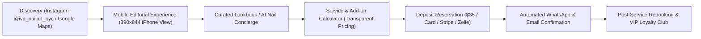

# 💅 Product Requirements Document (PRD) — IVA Nail Art NY
**Domain:** `ivanailartny.com` | **Instagram:** `@iva_nailart_nyc` | **Location:** Brooklyn, NY  
**Owner:** Director of Product & Strategy (CPO)  
**Status:** Approved for Production Engineering  

---

## 1. Executive Summary & Market Positioning
IVA Nail Art NY is an ultra-luxury private nail atelier based in Brooklyn, NY. Unlike high-volume street salons, IVA operates on an exclusive appointment model (maximum 3 clients per day, dedicated 3 to 4-hour blocks) specializing in medical-grade Russian Manicures, structured Builder Gel (BIAB), Japanese Gel-X extensions, and bespoke editorial nail art.

The primary customer journey starts on **Instagram (`@iva_nailart_nyc`)** or **Google Maps (Local Search)** and converts through a seamless mobile-first editorial digital experience into a confirmed appointment with deposit protection.

---

## 2. Customer Conversion Funnel

1. **Top of Funnel (Discovery):** Client views nail art transformation on Instagram Reels or searches "Russian Manicure Brooklyn / NYC" on Google.
2. **Engagement & Desire:** Arrives at `ivanailartny.com`. Immediately greeted with hospital-grade trust indicators, pregnancy-safe certifications, and high-fashion editorial imagery.
3. **Exploration:** Uses the **Filterable Lookbook** or consults the **AI Nail Concierge** to choose a design and estimate duration/price.
4. **Action:** Selects core service + nail art tier, selects preferred date, provides contact details, and pays deposit.
5. **Confirmation & Retention:** Instant booking receipt, calendar invite, automated 24h reminder, and post-appointment re-booking trigger for 3 weeks out.

---

## 3. High-End Service Catalog & Pricing Matrix

| Service Category | Service Name | Duration | Price (USD) | Deposit | Description |
| :--- | :--- | :--- | :--- | :--- | :--- |
| **Russian Manicure** | *The Signature Russian Dry Mani* | 90 min | $110 | $35 | E-file dry cuticle contouring, deep clean pocket, strengthening keratin base, single-tone luxury gel finish. |
| **Builder Gel (BIAB)** | *Aureate Structured Gel Overlay* | 105 min | $130 | $35 | Reinforces natural nails with flexible multi-layer builder gel; ideal for growth and long-lasting strength (3-4 weeks). |
| **Gel-X Extensions** | *Apothecary Full Set Gel-X* | 120 min | $150 | $35 | 100% soft gel extension system cured onto natural nail. Zero damage, odorless, perfectly sculpted shapes (Almond, Coffin, Square). |
| **Custom Nail Art Tier 1** | *Minimalist Editorial Accent* | +20 min | +$30 | Included | Subtle chrome glaze, micro-french, isolated negative space lines, or delicate pearl accents (up to 4 nails). |
| **Custom Nail Art Tier 2** | *Artisan Hand-Painted Design* | +45 min | +$65 | Included | Complex botanical motifs, tortoiseshell, aura gradients, layered chromes, and mixed foil across all 10 nails. |
| **Custom Nail Art Tier 3** | *Haute Couture 3D & Crystals* | +60 min | +$95 | Included | 3D sculpted gel textures, genuine Swarovski crystals, metallic encapsulation, bespoke runway concepts. |
| **Safe Removal** | *Gentle E-file Removal & Care* | 30 min | $35 | $10 | Safe removal preserving 100% natural nail plate integrity. Complimentary when reapplying new set. |

---

## 4. Client Retention & Loyalty Strategy
1. **The 3-Week Rebooking Protocol:**
   - 18 days after appointment, an automated, discreet WhatsApp concierge message invites the client to secure their maintenance slot before public slots open.
2. **Digital Gift Cards & Bridal Packages:**
   - Bespoke digital vouchers for luxury gifting, bridal shower sets, and editorial photoshoot bookings.
3. **VIP Birthday Privilege:**
   - Complimentary luxury hand massage & cuticle oil elixir during their birthday month.

---

## 5. Cancellation & Deposit Policy
* **Deposit Requirement:** A non-refundable **$35 deposit** is required to secure every appointment slot (deducted from the final service total).
* **Rescheduling Policy:** Up to **48 hours notice** allows 1 free transfer of the deposit to a new date within 30 days.
* **No-Show / Late Cancellation (<24 hours):** Deposit is forfeited to compensate the artist for reserved 4-hour blocks.
* **Punctuality:** 15-minute grace period. Beyond 15 minutes, nail art complexity may be reduced to respect the next booking.
